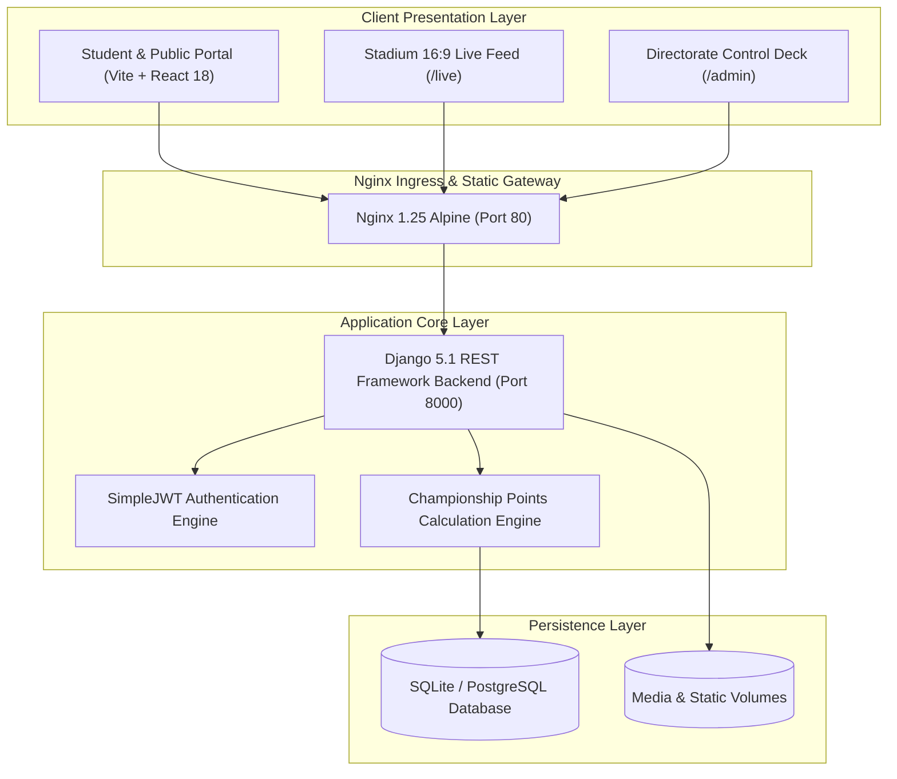

# NIMS Abhivyakti 2026 – Cultural Championship Platform

Official Digital Operations, Live Score Engine, Schedule, Contingent Registry, And Leaderboard Platform For **Abhivyakti 2026** — The Flagship Annual Inter-College Cultural Championship At **NIMS University Rajasthan, Jaipur**.

---

## 1. Executive Summary & Design System

Abhivyakti 2026 Unites Over 12 Autonomous Institutes And 5,000+ Students In A Grand Two-Day Cultural Showcase Across 6 Dedicated Cultural Arenas. The Platform Features A High-Luxury Visual Design Tailored To Match The Grandeur Of The Festival:

- **Primary Canvas**: Deep Imperial Burgundy & Midnight Wine (`#0E0204`, `#170306`, `#220409`)
- **Royal Accents**: Polished Antique Gold & Radiance Yellow (`#F5B842`, `#FACC15`, `#D4AF37`)
- **Highlight Embers**: Ruby Crimson & Radiant Rose (`#881337`, `#BE123C`, `#E11D48`)
- **Typography**: Regal Serif (`Cinzel`) For Hero Proclamations And Contemporary Geometrics (`Poppins`, `Inter`) For Operational Data

---

## 2. Key Modules & Features

### 🏆 Live Championship Scoring Engine & Leaderboard
- Real-Time Point Computation Across All 15 Official Competitions:
  - **1st Place (Gold 🥇)**: 40 Points
  - **2nd Place (Silver 🥈)**: 25 Points
  - **3rd Place (Bronze 🥉)**: 15 Points
  - **Participation**: 5 Points
- 3D-Styled Championship Podium For Gold, Silver, And Bronze Frontrunners
- Searchable Contingents Table With Filter By College Name, Code, And Medals Tally

### 🎭 15 Verified Schedule Competitions Across 6 Cultural Arenas
Exact Schedule Matching The Official Festival Directorate Registry:
1. **Dance - Solo, Duet & Group (Round 1)** – Rajeshwari Auditorium – 21 Nov 10:00 AM
2. **Singing - Solo, Duet & Group (Round 1)** – Management LT 10 & 11 – 21 Nov 10:00 AM
3. **Face Painting** – Management LT 16 & 17 – 21 Nov 02:00 PM
4. **Best Out Of Waste** – Management LT 21 – 21 Nov 02:00 PM
5. **Fashion Upcycling** – Fashion Lab & LT 16, 17 – 21 Nov 03:00 PM
6. **Doodling Competition** – Moot Court 2 – 21 Nov 04:00 PM
7. **Collage Making** – LT 21, 15 – 21 Nov 04:00 PM
8. **Clay Art** – Corridor 1st Floor – 21 Nov 04:00 PM
9. **Mono Act** – Rajeshwari Auditorium – 22 Nov 09:00 AM
10. **Dance - Solo, Duet & Group (Round 2)** – Rajeshwari Auditorium – 22 Nov 11:00 AM
11. **Singing - Solo, Duet & Group (Round 2)** – LT 10 & 11 – 22 Nov 11:00 AM
12. **AI Art** – LT 25 – 22 Nov 02:00 PM
13. **Calligraphy** – Moot Court – 22 Nov 02:00 PM
14. **MakeUp Contest** – LT 16, 17 & Corridor 2nd Floor – 22 Nov 02:30 PM
15. **Kick Drip** – LT 21 & 15 – 22 Nov 02:30 PM

### 📺 Dedicated 16:9 Stadium Broadcast Display (`/live`)
- Fullscreen View Designed For High-Lumen Auditorium Projectors And LED Video Walls
- Real-Time Auto-Refreshing Standings, High-Contrast Podium, And Live Ticker Of Recent Category Winners

### 🛡️ Directorate Control Deck (Admin Suite)
- **Role-Based Access Control (RBAC)**: Super Admin, Fest Coordinator, Official Jury, Score Operator, And Read-Only Viewer
- **Jury Scoring Deck**: Raw Score Evaluation (0-100), Rank Allocation, Notes, And Score Verification
- **Events & Schedule Manager**: Configure Start Times, Venues, Maximum Contingent Limits, And Round Progression
- **Contingents Manager**: Manage Deans, Student Contingent Leads, And Contact Records For All 12 Colleges
- **Media Gallery Archive**: Curate Official High-Resolution Photography And Highlights
- **Platform Parameters**: Marquee Ticker Controls, Live Status Toggles, And Countdown Clock Overrides

### 🔍 Search Engine Optimization (SEO) & Security
- **JSON-LD Schema**: Full Google-Compliant `Festival` Structured Data
- **Social Tags**: OpenGraph (`og:*`) And Twitter Card (`twitter:*`) Metadata
- **Crawl Control**: Strict `robots.txt` And Canonical `sitemap.xml`
- **Security Protocols**: HTTP-Only JWT Cookie Architecture, Django Security Middleware, CSP, XSS Protection, And Frame Guard

---

## 3. Technology Architecture



---

## 4. Quickstart & Local Execution

### Prerequisites
- Python 3.10+
- Node.js 18+ And npm
- Git

### Backend Setup
```powershell
cd Backend
python -m venv venv
.\venv\Scripts\Activate.ps1
pip install -r requirements.txt
python manage.py migrate
python manage.py seed
python manage.py runserver 0.0.0.0:8000
```

### Frontend Setup
```powershell
cd Frontend
npm install
npm run dev
```

### Running Automated Verification Suite
```powershell
python Scripts/VerifyFullSystem.py
```

---

## 5. Directorate Seed Credentials

| Role | Email | Password |
| :--- | :--- | :--- |
| **Super Admin** | `admin@nims.ac.in` | `Abhivyakti@2026` |
| **Fest Coordinator** | `coordinator@nims.ac.in` | `Abhivyakti@2026` |
| **Official Jury** | `judge@nims.ac.in` | `Abhivyakti@2026` |

---

## 6. Production Container Deployment

```powershell
# Build and run containers
docker-compose up --build -d

# Inspect health and logs
docker-compose ps
docker-compose logs -f
```

---

*Formulated And Maintained By The NIMS University Student Council Directorate Of Cultural Affairs.*
