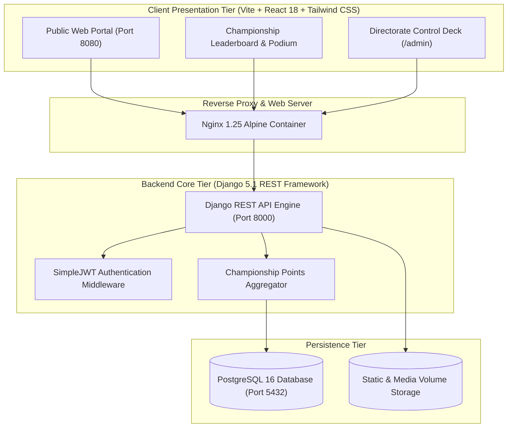

# NIMS Abhivyakti 2026 – Cultural Championship Platform

Official Digital Operations, Live Score Engine, 4-Day Event Schedule, Interactive Rulebooks, Contingent Registry, And Championship Leaderboard Platform For **Abhivyakti 2026** — The Flagship Annual Inter-College Cultural Championship At **NIMS University Rajasthan, Jaipur**.

---

## 1. Executive Summary & Design Philosophy

Abhivyakti 2026 Unites Over 12 Autonomous Institutes, 30+ Competing Contingents, And 5,000+ Students Across A Historic Four-Day Cultural Championship (18 November To 21 November 2026). The Visual Architecture Employs A Theatrical Luxury Palette Inspired By Royal Festivities:

- **Primary Canvas**: Deep Imperial Burgundy & Midnight Wine (`#050002`, `#0E0204`, `#170306`)
- **Royal Accents**: Polished Antique Gold & Radiance Yellow (`#F5B842`, `#FACC15`, `#D4AF37`)
- **Highlight Embers**: Ruby Crimson & Radiant Rose (`#881337`, `#BE123C`, `#E11D48`)
- **High-Contrast Clarity**: Pure Brilliant White (`#FFFFFF`, `#F8FAFC`) For Sharp Legibility And Visual Prominence
- **Theatrical Atmospheric Lighting**: Diagonal Stage Spotlights, Astrolabe Rings In All Four Corners, Rising Golden Sparks, And Ambient Radial Glows

---

## 2. Key Modules & Functional Architecture

### 🏆 Real-Time Championship Leaderboard & Podium
- **Live Scoring Engine**: Cumulative Points Aggregation Across All 15 Cultural Competitions:
  - **1st Place (Gold 🥇)**: 40 Championship Points
  - **2nd Place (Silver 🥈)**: 25 Championship Points
  - **3rd Place (Bronze 🥉)**: 15 Championship Points
  - **Contingent Arena Participation**: 5 Bonus Points
- **Top 3 Elevated Podium**: Dedicated Gold, Silver, And Bronze Pedestals Celebrating Frontrunning Colleges With Animated Emblems
- **Interactive Standings Table**: Instant Search By College Name Or Department Code, Live Medal Counts, And High-Contrast White Typography

### 📅 Four-Day Official Championship Schedule (18-21 November 2026)
15 Verified Competitions Distributed Across 6 Multidisciplinary Arenas:
- **Day 1 (18 Nov 2026)**:
  1. Dance - Solo & Duet (Round 1 Prelims) – Rajeshwari Auditorium – 10:00 AM
  2. Singing - Solo & Duet (Round 1 Prelims) – Management LT 10 & 11 – 10:00 AM
  3. Face Painting – Management LT 16 & 17 – 02:00 PM
  4. Best Out Of Waste – Management LT 21 – 02:00 PM
- **Day 2 (19 Nov 2026)**:
  5. Fashion Upcycling – Fashion Lab & LT 16, 17 – 11:00 AM
  6. Doodling Competition – Moot Court 2 – 02:00 PM
  7. Collage Making – LT 21, 15 – 03:00 PM
  8. Clay Art – Corridor 1st Floor – 04:00 PM
- **Day 3 (20 Nov 2026)**:
  9. Mono Act (Theatrical Soliloquy) – Rajeshwari Auditorium – 10:00 AM
  10. AI Art & Digital Prompt Challenge – LT 25 – 02:00 PM
  11. Calligraphy Championship – Moot Court – 03:00 PM
  12. MakeUp & Glamour Contest – LT 16, 17 & Corridor 2nd Floor – 04:00 PM
- **Day 4 (21 Nov 2026 - Mega Grand Championship Finale)**:
  13. Kick Drip (Sneaker Customization) – LT 21 & 15 – 10:00 AM
  14. Singing - Group & Battle Of The Bands (Grand Finale) – LT 10 & 11 – 01:00 PM
  15. Dance - Group Championship (Mega Grand Finale) – Rajeshwari Auditorium – 04:00 PM

### 📖 Attached Event Rulebooks & 4-Pillar Scoring Rubrics
- No Disconnected Guideline Pages — Official Rulebooks, Time Limits, Venue Specifications, Team Size Constraints, And Evaluation Rubrics Are Directly Attached To Every Competition Card Via An Interactive Modal Dialog.

### 🛡️ Directorate Control Deck (Admin & Jury Suite)
- **Role-Based Access Control (RBAC)**: Super Admin, Cultural Dean, Official Jury Member, And Score Operator
- **One-Click Pre-Configured Credentials**:
  - **Super Administrator**: `admin@nims.ac.in` | `Abhivyakti@2026`
  - **Official Jury Lead**: `judge@abhivyakti.nsiif.org` | `JudgePassword123!`
- **Score Matrix Engine**: Numerical Scoring (0-100), Rank Allocation, Notes, And Cryptographic Score Verification
- **Contingent Registry**: Roster Management For All 12 Colleges, Faculty Mentors, And Student Captains

---

## 3. Technology Architecture & Stack



### Stack Components:
- **Frontend**: React 18, TypeScript, Tailwind CSS, Lucide React, Vite
- **Backend**: Python 3.12, Django 5.1, Django REST Framework, SimpleJWT
- **Database**: PostgreSQL 16 (With Automated Healthchecks)
- **Containerization**: Docker Compose Multi-Container Orchestration

---

## 4. Local Deployment & Docker Setup

### Prerequisites
- Docker Engine & Docker Compose Installed On Host System
- Git Command-Line Tools

### Quick Start
```bash
# Clone The Official Repository
git clone https://github.com/i8o8i-Developer/NIMS-ABHIVYAKTI-2026.git
cd NIMS-ABHIVYAKTI-2026

# Spin Up Complete Infrastructure
docker compose up -d --build

# Verify Container Health
docker compose ps
```

### Port Mappings:
| Service | Internal Port | Host Port | URL / Endpoint |
| :--- | :--- | :--- | :--- |
| **Frontend Web Portal** | 80 | `8080` | `http://localhost:8080/` |
| **Backend REST API** | 8000 | `8000` | `http://localhost:8000/api/` |
| **PostgreSQL Database** | 5432 | `5432` | `localhost:5432` |

---

## 5. Security & Governance Standards

- **Cross-Origin Resource Sharing (CORS)**: Strict Whitelisting Of Production And Staging Hostnames
- **Content Security Policy (CSP)**: Hardened Headers Mitigating Cross-Site Scripting (XSS)
- **Strict PascalCase Standard**: 100% Of All Project Files And Folders Follow Rigorous PascalCase Nomenclature
- **Strict Title Case Standard**: All User-Facing Messages, Commit Logs, Error Text, And Documentation Comply With Strict Title Case Formatting

---

## 6. Official Directorate Contacts

- **Directorate Office**: NIMS University Student Council & Fest Directorate
- **Venue**: Central Grounds & Rajeshwari Auditorium, NIMS University Rajasthan, Jaipur
- **Championship Dates**: 18 November 2026 – 21 November 2026
